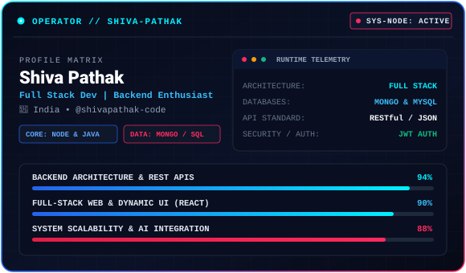
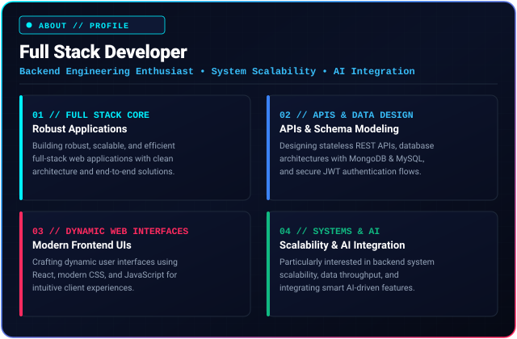
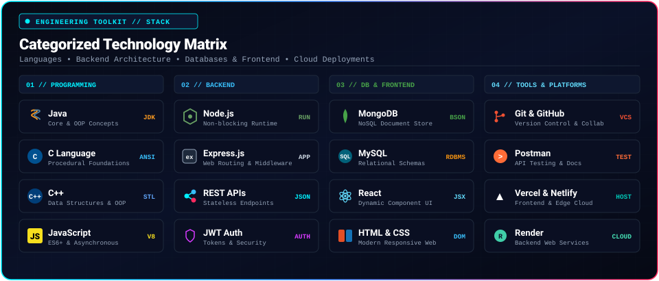

<!-- 1. HERO SECTION -->

  

<!-- TOP STATUS BADGES -->

  
  &nbsp;
  
  &nbsp;
  

<!-- SIDE-BY-SIDE HERO PORTRAIT & TELEMETRY DASHBOARD -->
<table width="100%" border="0" cellpadding="0" cellspacing="0">
  <tr>
    <td width="35%" align="center" valign="middle">
      
    </td>
    <td width="65%" align="center" valign="middle">
      
    </td>
  </tr>
</table>

---

<!-- 2. ABOUT ME SECTION -->
### 🧭 About Me

<blockquote>
  <b>Full Stack Developer | Backend Engineering Enthusiast</b>  
  I build robust, scalable, and efficient full-stack applications. From designing REST APIs and database architectures to building dynamic web interfaces, I enjoy solving complex problems end-to-end. I am particularly interested in backend engineering, system scalability, and AI integration.
</blockquote>

 

  

 

---

<!-- 3. CATEGORIZED TECHNOLOGY STACK -->
### 🛠️ Categorized Technology Stack

  

 

#### 💻 Programming Languages

  
  &nbsp;
  
  &nbsp;
  
  &nbsp;
  

#### ⚙️ Backend &amp; Architecture

  
  &nbsp;
  
  &nbsp;
  
  &nbsp;
  
  &nbsp;
  
  &nbsp;
  

#### 🎨 Frontend &amp; Dynamic UI

  
  &nbsp;
  
  &nbsp;
  

#### 🧰 Tools &amp; Cloud Platforms

  
  &nbsp;
  
  &nbsp;
  
  &nbsp;
  
  &nbsp;
  
  &nbsp;
  

 

---

<!-- 4. FEATURED PROJECTS -->
### 📂 Featured Architectural Projects

<table>
  <!-- PROJECT 1 -->
  <tr>
    <td width="100%">
      <h3>⚖️ 01. Judiciary Case Backlog Reduction System</h3>
      

        An intelligent workflow and case scheduling management engine engineered to optimize judicial docket allocation. Designed to mitigate court pendency through rule-based triage, automated urgency classification, and structured digital tracking for case lifecycles.
      

      

        <b>Architecture:</b> Modular backend API handling legal case records, database indexing, and docket timelines.
      

      

        <code>Java</code> &nbsp;•&nbsp; <code>Node.js</code> &nbsp;•&nbsp; <code>Express.js</code> &nbsp;•&nbsp; <code>MongoDB</code> &nbsp;•&nbsp; <code>REST APIs</code>
      

      

        🔗 <a href="https://github.com/shivapathak-code/judiciary-case-backlog-reduction"><b>View Repository (Placeholder) &rarr;</b></a>
      

    </td>
  </tr>

  <!-- PROJECT 2 -->
  <tr>
    <td width="100%">
      <h3>🔐 02. Task Manager REST API</h3>
      

        A secure, production-structured backend web service delivering complete CRUD capabilities with clean separation of concerns across controllers, middleware, and database models.
      

      

        <b>Capabilities:</b> JWT token authentication, bcrypt password hashing, role-based access control (RBAC), query pagination, task filtering, sorting, and centralized error logging.
      

      

        <code>Node.js</code> &nbsp;•&nbsp; <code>Express.js</code> &nbsp;•&nbsp; <code>MongoDB</code> &nbsp;•&nbsp; <code>MySQL</code> &nbsp;•&nbsp; <code>JWT Auth</code> &nbsp;•&nbsp; <code>Postman</code>
      

      

        🔗 <a href="https://github.com/shivapathak-code/task-manager-rest-api"><b>View Repository (Placeholder) &rarr;</b></a>
      

    </td>
  </tr>

  <!-- PROJECT 3 -->
  <tr>
    <td width="100%">
      <h3>🛍️ 03. Boutique E-Commerce Website</h3>
      

        A full-stack commercial web application tailored for boutique merchandise. Connects an interactive React frontend with transactional backend APIs for dynamic browsing and order workflows.
      

      

        <b>Capabilities:</b> Dynamic product catalog rendering, category filtering, cart state management, customer session tracking, and RESTful checkout pipelines.
      

      

        <code>React</code> &nbsp;•&nbsp; <code>Node.js</code> &nbsp;•&nbsp; <code>Express.js</code> &nbsp;•&nbsp; <code>MongoDB</code> &nbsp;•&nbsp; <code>CSS3</code> &nbsp;•&nbsp; <code>REST APIs</code>
      

      

        🔗 <a href="https://github.com/shivapathak-code/boutique-ecommerce"><b>View Repository (Placeholder) &rarr;</b></a>
      

    </td>
  </tr>
</table>

 

---

<!-- 5. GITHUB STATISTICS DASHBOARD -->
### 📊 GitHub Analytics &amp; Statistics

<!-- Row 1: Profile Stats & Streak Stats -->
<table width="100%" border="0" cellpadding="0" cellspacing="0">
  <tr>
    <td width="50%" align="center" valign="middle">
      
    </td>
    <td width="50%" align="center" valign="middle">
      
    </td>
  </tr>
</table>

 

<!-- Row 2: Top Languages -->

  

 

---

<!-- 6. GITHUB TROPHIES & TOP CONTRIBUTED REPOSITORIES -->
### 🏆 GitHub Trophies &amp; Contributions

<!-- Trophies -->

  

 

<!-- Top Contributed Repositories -->

  

 

---

<!-- 7. CONNECT SECTION (POINTING CHARACTER & SOCIAL LINKS) -->
### 📡 Connect &amp; Collaborate

<table width="100%" border="0" cellpadding="0" cellspacing="0">
  <tr>
    <td width="28%" align="center" valign="bottom">
      
    </td>
    <td width="72%" align="center" valign="middle">
      
    </td>
  </tr>
</table>

 

<!-- Clickable Social Badges -->

  
  &nbsp;&nbsp;
  
  &nbsp;&nbsp;
  

 

---

<!-- 8. MINIMAL FOOTER WITH VISITOR COUNTER -->

  

Crafted with precision for <b>Shiva Pathak</b> • Full Stack Developer | Backend Engineering Enthusiast

